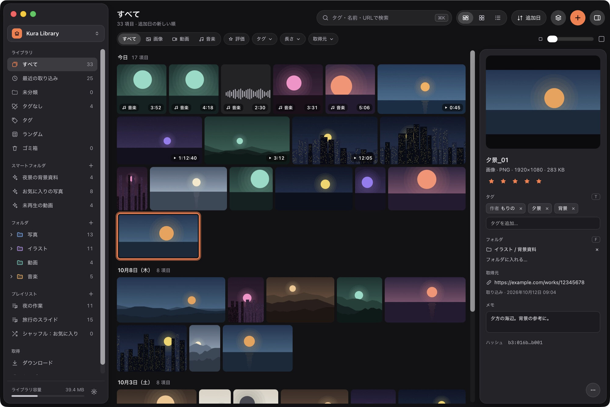
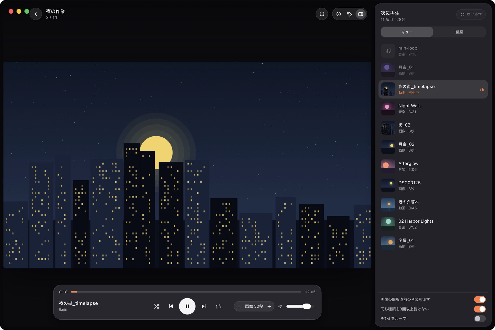
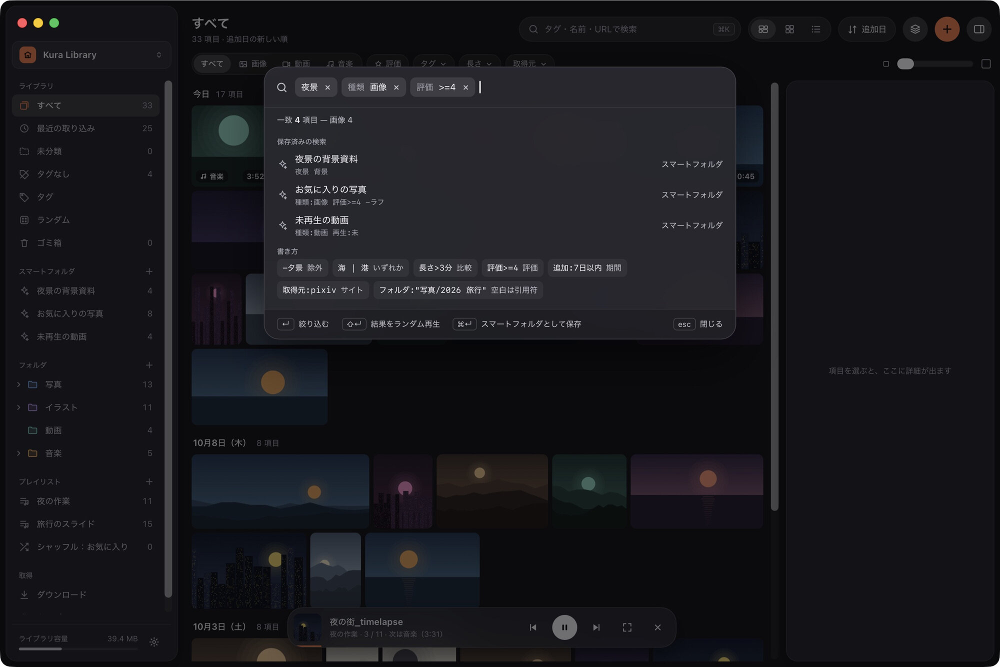

# Kura

画像・音楽・動画をひとつのライブラリで管理し、種類を混ぜたプレイリストで再生する、個人用の macOS アプリです。
Tauri 2（Rust）と React / TypeScript で作っています。名前の「Kura」は仮称です。



## 特長

- **元のファイルを壊さない取り込み**：ファイルはライブラリへコピーし（同じボリュームなら APFS クローンで容量を使わない）、取り込み元は移動も変更もしない。内容のハッシュ（BLAKE3）で重複を見分ける。
- **整理**：仮想フォルダ（1 つのアイテムを複数のフォルダに入れられる）、名前空間・別名・親子関係を持つタグ、評価・メモ、まとめて扱う「ユニット」、スマートフォルダ（保存した検索）。
- **検索**：⌘K のパレットで、`夜景 種類:画像 評価>=4` のような検索言語で絞り込む。
- **混ぜて再生**：画像・音楽・動画を 1 つのプレイリストに並べ、画像の間も直前の音楽を流し続けられる。ファイル単位とユニット単位を切り替えられ、シャッフルはシードを固定して再現できる。
- **取得**：URL を貼ると yt-dlp / gallery-dl で取得して取り込み、投稿者・タグなどのメタデータも反映する。Web ページのキャプチャもできる。
- **速さ**：10 万件のライブラリで、起動から操作できるまで 1.5 秒以内、グリッドのスクロール 60fps を目標に作っている。重い処理は Rust 側で行う。

## 画面

| シアター再生と「次に再生」 | ⌘K 検索パレット |
| --- | --- |
|  |  |

画面に写っている画像・動画・音楽は、すべてこのリポジトリのために図形と合成音で生成したダミーです。

## 動作環境

- macOS 26 以降、Apple Silicon
- 配布用のビルドはまだありません。下の手順でソースからビルドしてください。

### 外部ツール（任意）

ダウンロード・再生用プロキシ・キャプチャなどの機能は、次のツールを呼び出して動きます。
Kura にはどれも同梱しておらず、利用者が入れたものを別のプロセスとして実行するだけです。
`/opt/homebrew/bin` と `/usr/local/bin` から探し、見つからないときは設定で場所を指定できます。

```bash
brew install yt-dlp gallery-dl deno ffmpeg
```

| ツール | 使う機能 | ライセンス（参考） |
|---|---|---|
| [yt-dlp](https://github.com/yt-dlp/yt-dlp) | 動画・音楽のダウンロード | Unlicense |
| [gallery-dl](https://github.com/mikf/gallery-dl) | 画像のダウンロード | GPL-2.0 |
| [deno](https://deno.com/) | yt-dlp が一部のサイトで使う JavaScript の実行 | MIT |
| [FFmpeg](https://ffmpeg.org/)（ffmpeg / ffprobe） | 再生用プロキシの作成、メディア情報 | LGPL-2.1 以降または GPL（ビルドによる） |
| [Google Chrome](https://www.google.com/chrome/) | Web ページのキャプチャ | Google の利用規約 |
| [mpv](https://mpv.io/) | 外部プレイヤーで開く | GPL-2.0 以降 / LGPL-2.1 以降 |

ダウンロード・キャプチャは、自分に権利があるか利用が許されたコンテンツに対して、各サイトの利用規約に従って使ってください。

## ビルド

必要なもの：

- Xcode（Swift ヘルパーのビルド）
- Rust 1.99.0（`rustup`。リポジトリの `rust-toolchain.toml` で固定していて、`rustup` が自動で入れる。ADR-165）
- Node.js（LTS）と pnpm（`corepack enable`）
- [cargo-about](https://github.com/EmbarkStudios/cargo-about)（依存ライブラリのライセンス一覧の生成。`cargo install --locked cargo-about`）

```bash
pnpm install
```

```bash
pnpm tauri dev
```

配布用のビルドは `pnpm tauri build` です。`target/release/bundle/` に `Kura.app` と `.dmg` ができます（署名・公証はしていません）。

## 開発

| 目的 | コマンド |
|---|---|
| 開発起動 | `pnpm tauri dev` |
| Rust のテスト | `cargo test --workspace` |
| Rust の lint | `cargo clippy --workspace --all-targets -- -D warnings` |
| 整形 | `cargo fmt --all` と `pnpm run format` |
| 型チェック | `pnpm run typecheck` |
| フロントのテスト | `pnpm test` |
| 依存ライブラリのライセンス一覧 | `pnpm run licenses`（確認だけなら `pnpm run licenses:check`） |
| ダミーライブラリの生成 | `cargo run -p kura-devtools -- seed --items 100000 --out /tmp/bench.kuralib` |

開発は [Claude Code](https://claude.com/claude-code) で進めています。プロジェクトの指示は [`CLAUDE.md`](CLAUDE.md)、ファイルの種類ごとのルールと手順（`/verify` など）は [`.claude/`](.claude) にあります。
作業は [`docs/roadmap.md`](docs/roadmap.md) のマイルストーン単位で進め、M0〜M9 まで終わっています。

### リポジトリ構成

```text
crates/kura-core/      OS に依存しないドメインロジック（DB、取り込み、検索、ユニット、プレイリスト、ジョブ）
crates/kura-mac/       macOS 専用の機能（サムネイル、メディア情報、スナップショット。Swift ヘルパー）
crates/kura-devtools/  ダミーライブラリの生成とベンチマーク
src-tauri/             Tauri アプリ本体（コマンド、kura:// プロトコル、ウィンドウ）
src/                   React のフロントエンド
docs/                  仕様と設計
```

### ドキュメント

- [`docs/requirements.md`](docs/requirements.md)：機能要件・非機能要件・対象外
- [`docs/architecture.md`](docs/architecture.md)：構成、IPC、`kura://` プロトコル、ジョブ、外部ツール
- [`docs/data-model.md`](docs/data-model.md)：SQLite のスキーマ
- [`docs/playlists.md`](docs/playlists.md)：ユニットとプレイリスト、シャッフル、再生
- [`docs/search-query.md`](docs/search-query.md)：検索言語と ⌘K パレット
- [`docs/design.md`](docs/design.md)：デザインの方針と部品（モックは [`docs/design/mockups/`](docs/design/mockups)）
- [`docs/decisions.md`](docs/decisions.md)：設計判断の記録

### まだ決めていないこと

- アプリ名（「Kura」は仮称。バンドル ID は `dev.kura.Kura` に決めた。ADR-18）
- ライトモードの有無（v1 はダークのみ）
- ユニットの画面上の呼び名（「ユニット」で仮置き）

## ライセンス

Kura は次のどちらかのライセンスを選んで利用できます（二重ライセンス）。

- MIT License（[LICENSE-MIT](LICENSE-MIT)）
- Apache License 2.0（[LICENSE-APACHE](LICENSE-APACHE)）

例外として、次のものは元のライセンスに従います。

- `crates/vorbis-tables/` と `crates/kura-engine/src/codec/vorbis/`・`crates/kura-engine/src/codec/ogg.rs`（aoTuV・libvorbis・libogg のエンコーダを移したもの）：BSD-3-Clause（aoTuV の Aoyumi と Xiph.org Foundation の著作権表示。[crates/vorbis-tables/LICENSE](crates/vorbis-tables/LICENSE)）。そのため `kura-engine` のライセンスは `(MIT OR Apache-2.0) AND BSD-3-Clause`。
- `third_party/` の各クレート（不具合を直した写し）：それぞれの元のライセンス（`symphonia-codec-vorbis` は MPL-2.0。変更は各ディレクトリの `KURA.md`）。

このリポジトリに送られた貢献は、明示しない限り、Apache License 2.0 の定義に従い、追加の条件なしに上と同じ二重ライセンスで提供されるものとします。

配布する `Kura.app` に含まれる第三者のライブラリのライセンス表記は [THIRD_PARTY_LICENSES.md](THIRD_PARTY_LICENSES.md) にまとめています（`pnpm run licenses` で生成し、アプリの `Contents/Resources` にも入ります）。
